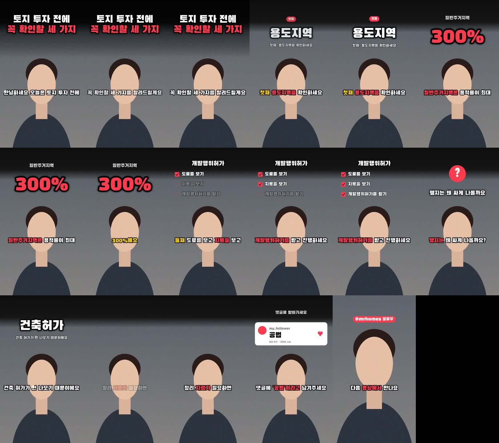
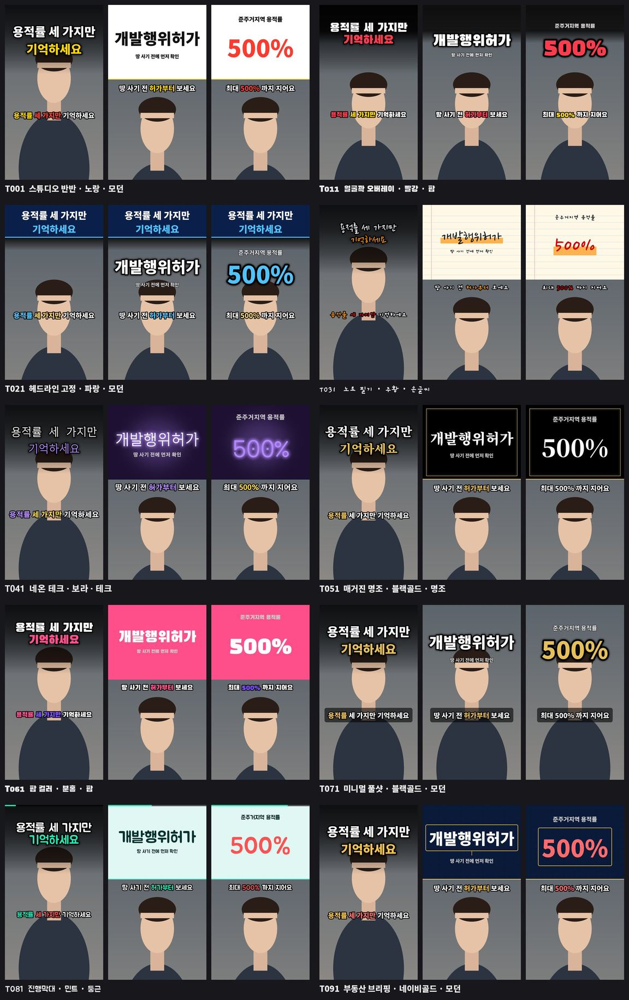
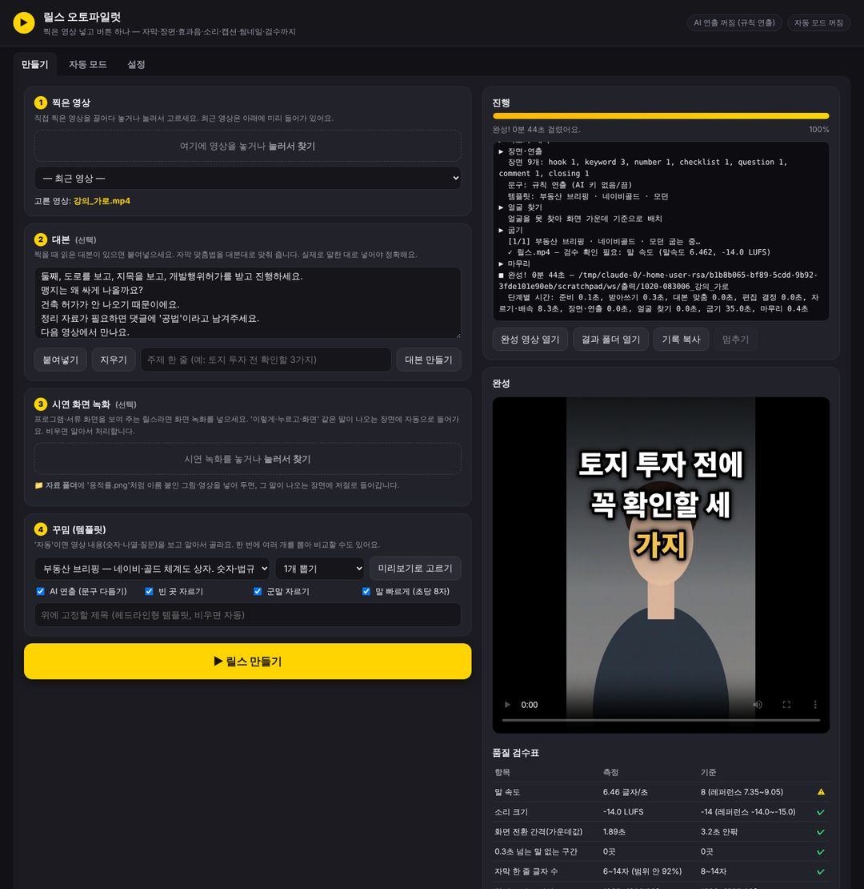

# 릴스 오토파일럿 🎬 + 스레드 자동화 봇 🧵

찍은 영상을 넣으면 **업로드 직전까지** 알아서 만드는 릴스·쇼츠 자동 편집 프로그램과,
메타 공식 API로 스레드 글 발행·댓글 자동답글을 돌리는 봇이 들어 있는 저장소입니다.

- **릴스 오토파일럿** — 이 문서
- **스레드 자동화 봇** — [docs/threads_bot.md](docs/threads_bot.md)

---

## 릴스 오토파일럿 — 찍은 영상 넣고 버튼 하나

『하루 걸리던 릴스 편집, 버튼 하나로 5분 22초』(노리쌤)의 '릴스공장/브랜딩메이커' 설계를 그대로 옮기고,
사람 손이 남아 있던 곳을 더 자동으로 바꾼 프로그램입니다.

> 찍은 영상 → 받아쓰기 → 대본으로 자막 바로잡기 → 빈 곳·군말 자르기 → 초당 8글자로 빠르게
> → 장면 나누기 → 자막·카드·효과음 → **-14 LUFS · 1080×1920 · 30프레임**
> → **캡션·해시태그·첫 댓글·썸네일·자막(SRT)** → **품질 검수표**



### 무엇이 더 자동화됐나

| | 릴스공장 / 브랜딩메이커 (책·영상) | 릴스 오토파일럿 |
|---|---|---|
| 시작 | 네 칸 채우고 노란 버튼 | 같은 화면 **+ 자동 모드**: '넣는곳' 폴더에 영상만 넣으면 버튼도 없이 편집 |
| 대본 | 딥시크 키로 '대본 만들기' | Claude 로 대본 만들기, 키가 없으면 빈칸 대본 |
| 화면 문구 | 규칙으로 | 규칙 **+ Claude 연출**(훅 제목·카드 문구·강조어) — 숫자·사실·타이밍은 AI 가 못 바꾸게 잠금 |
| 결과물 | 완성 영상 | 완성 영상 **+ 캡션·해시태그·첫 댓글·썸네일·SRT 자막** |
| 확인 | 눈으로 | 완성본을 **다시 재서** 설계도 숫자와 비교한 **검수표** 자동 작성 |
| 기준 숫자 | 68개를 한 번 측정해 고정 | `bench` 로 내가 고른 레퍼런스를 언제든 재서 **기준값 자동 교체** |
| 템플릿 | 한 번에 하나 | 내용(숫자·나열·질문)을 보고 **자동 선택** + 한 번 받아쓰기로 **여러 템플릿 동시 출력**(A/B 비교) |
| 그림·자료 | 시연 화면 녹화 | 시연 녹화 자동 배치 **+ 자료 폴더**: `용적률.png` 처럼 이름 붙인 파일이 그 말이 나오는 장면에 자동 삽입 |
| 빈 곳 자르기 | 받아쓰기 시각 기준 | 받아쓰기 **+ 소리 에너지로 낱말 경계를 다시 재서** 침묵을 더 정확히 자름 |
| 분야 | 일반 | **부동산·공법 강조 사전**(용적률·건폐율·개발행위허가·지구단위계획…) 내장 + 내 사전 |
| 같은 영상 다시 | 받아쓰기 건너뛰기 | 같음 (파일 이름이 바뀌어도 내용으로 알아봄) |

**아직 없는 것** (책에는 있음): 등록해 둔 프로그램 화면 25개를 스스로 녹화하는 기능, 찍은 영상이 없을 때 캐릭터가 대신 말하는 기능.
템플릿 100개는 책처럼 인기 릴스 원본 100개를 하나씩 잰 것이 아니라, 책에 나온 실측 위치(턱 끝 1100px → 자막 1210px, 얼굴 280px 내림, 아래 1/5 비움 등)를 반영한 **기본 디자인 10종 × 색·글꼴 느낌 10가지 변형**입니다.



---

### 설치

**윈도우** (책과 같은 순서)

1. 이 저장소를 내려받아(초록 **Code → Download ZIP**) D드라이브처럼 넉넉한 곳에 풉니다.
2. 폴더 안 **`설치.bat`** 을 두 번 누릅니다. 파이썬·부품·무료 한글 글꼴 30종이 깔립니다(10~20분).
   파이썬이 없던 컴퓨터는 설치 후 **컴퓨터를 한 번 다시 켜고** `설치.bat` 을 한 번 더 누르세요.
3. **`릴스 만들기.vbs`** 를 두 번 누르면 검은 창 없이 브라우저에 프로그램 화면이 열립니다.

**맥**: `install_mac.command` → `릴스 만들기.command` 를 차례로 두 번 누르세요.

> 처음 '릴스 만들기'를 누르면 받아쓰기 모델(1.6GB)을 한 번 내려받느라 오래 걸립니다. 고장이 아니에요. 그다음부터는 없습니다.

### 사용법 — 네 칸 채우고 노란 버튼



1. **찍은 영상** — 끌어다 놓거나 눌러서 고릅니다. 최근 영상(동영상·다운로드·바탕화면)이 미리 들어가 있어요.
2. **대본**(선택) — 찍을 때 읽은 대본을 붙여넣으면 자막 맞춤법을 대본대로 맞춥니다. *실제로 말한 대로* 넣어야 정확해요.
   대본이 없으면 주제 한 줄 쓰고 **대본 만들기**.
3. **시연 화면 녹화**(선택) — 화면을 보여 주는 릴스라면 넣으세요. '이렇게·누르고·화면' 같은 말이 나오는 장면에 들어갑니다.
4. **꾸밈** — '자동'이면 영상 내용을 보고 고릅니다. **미리보기로 고르기**를 누르면 템플릿마다 실제 장면 세 장이 보이고,
   '내 영상으로 미리보기'를 켜면 내 얼굴로 다시 그려 줍니다. '2개 비교·3개 비교'로 한 번에 여러 꾸밈을 뽑을 수 있어요.

**▶ 릴스 만들기** 를 누르면 오른쪽에 진행 기록이 올라오고, 다 되면 완성 영상이 저절로 열립니다.
화면 아래에 **품질 검수표**와 **업로드 문구**(캡션·해시태그·첫 댓글 복사 버튼)가 나옵니다.
오류가 나면 **기록 복사**를 눌러 그대로 보내 주면 어디서 막혔는지 바로 알 수 있어요.

### 자동 모드 — 버튼도 없이

'자동 모드' 탭에서 켜 두면 `작업폴더/넣는곳` 에 영상을 넣기만 해도 편집됩니다.
같은 이름의 `.txt`(예: `용적률.mp4` + `용적률.txt`)를 함께 넣으면 대본으로 씁니다.
끝난 원본은 `넣는곳/완료`, 실패한 원본은 `넣는곳/실패` 로 옮겨집니다.
휴대폰 사진첩·클라우드 동기화 폴더를 '넣는곳'으로 지정해 두면 **찍어서 올리기만 하면 편집까지** 끝납니다.

### 결과물

`작업폴더/출력/날짜시각_영상이름/`

| 파일 | 내용 |
|---|---|
| `릴스.mp4` (여러 개면 `릴스_T001.mp4`…) | 1080×1920, 30프레임, -14 LUFS |
| `썸네일.jpg` | 첫 장면 얼굴 + 큰 제목 |
| `업로드문구.md` | 캡션·해시태그·첫 댓글 (그대로 복사) |
| `자막.srt` | 유튜브 등에 올릴 자막 |
| `릴스_검수.md` / `.json` | 말 속도·소리 크기·컷 간격·무음·자막 글자 수·화면 크기 검수표 |
| `받아쓰기.json` `편집.json` `장면.json` | 단계별 기록 (문제가 생기면 어느 단계인지 바로 보임) |

### 작업폴더 한눈에

| 폴더 | 쓰임 |
|---|---|
| `넣는곳/` | 자동 모드: 여기에 영상(+같은 이름 .txt)을 넣으면 알아서 편집 |
| `자료/` | `용적률.png`, `체계도.mp4` 처럼 이름 붙인 그림·영상 → 그 말이 나오는 장면에 자동 삽입 (도구 로고도 여기) |
| `효과음/` | `whoosh.wav` 처럼 같은 이름을 넣으면 내장 효과음 대신 사용 |
| `글꼴/` | 무료 한글 글꼴 30종 (설치 때 자동) |
| `사전.txt` | 한 줄에 하나씩 — 자막에서 노랗게 칠할 내 용어 |
| `settings.json` | 내 설정 (화면의 '설정' 탭에서 바꿈) |

### AI 연출 켜기 (선택)

`.env` 에 `ANTHROPIC_API_KEY=...` 를 넣거나 화면의 **설정 → AI 키**에 붙여넣으면
Claude(`claude-opus-5-5`)가 훅 제목·카드 문구·강조어·캡션·해시태그·첫 댓글과 대본을 씁니다.

- AI 에는 '보기 좋게' 대신 숫자로 지시합니다: 훅 16자 두 줄, 카드 제목 8자, 보조 16자, 강조어는 *실제로 말한 낱말 중에서만*.
- 결과가 숫자를 넘으면 프로그램이 다시 잘라 맞추고, 숫자 장면의 숫자·타이밍은 AI 가 바꿀 수 없습니다.
- 안전 분류기가 요청을 거절하면 서버가 다른 모델로 이어서 처리하도록(`fallbacks`) 켜 두었습니다.
- 키가 없거나 인터넷이 끊겨도 편집은 끝까지 돌고, 문구는 규칙으로 만듭니다.

내 말투·분야·계정은 [`reels_settings.example.json`](reels_settings.example.json) 을 `작업폴더/settings.json` 으로 복사해 고치면 됩니다
(부동산공법 강의용 예시가 들어 있어요).

### 설계도 숫자 (책 2·3장, 잘 되는 릴스 68개 가운데값)

| 숫자 | 값 | 코드 |
|---|---|---|
| 말 속도 | 초당 8글자 (실측 8.07, 7.35~9.05) | `settings.Targets.chars_per_sec` |
| 배속 범위 | 1.10 ~ 1.25배 | `speed_min`, `speed_max` |
| 빈 곳 자르기 | 0.16초 넘게 말이 없으면 → 0.1초만 남김 | `silence_gap`, `silence_keep` |
| 장면 덩어리 | 1.2초 이상으로 묶고 4.6초 넘으면 반으로 | `chunk_min`, `chunk_max` |
| 화면 전환 | 가운데값 3.2초 (반반형은 2초 이하) | `cut_interval` |
| 소리 크기 | -14 LUFS (2패스 loudnorm) | `loudness_lufs` |
| 자막 | 한 줄 8~14자, 아주 굵은 고딕, 흰 글씨, 핵심어만 강조색 | `subtitle_min_chars`… |
| 대본 맞춤 | 45% 넘게 같으면 통째로 / 낱말은 80% 또는 60%+글자차 1자 | `script_match_*` |
| 화면 | 1080×1920, 30프레임, 아래 1/5 비움, 얼굴 꽉 찬 화면 자막 1210px | `templates.py` |

내가 고른 레퍼런스로 바꾸려면 잘 되는 릴스를 한 폴더에 내려받아 두고:

```bash
python -m reels_autopilot bench 레퍼런스폴더 --apply   # 영상별 표(CSV)와 가운데값 → 기준값 저장
```

### 명령줄로 쓰기

```bash
python -m reels_autopilot ui                                  # 화면 띄우기
python -m reels_autopilot make 촬영.mp4 --script 대본.txt      # 한 편 만들기
python -m reels_autopilot make 촬영.mp4 --variants 3          # 자동으로 3가지 꾸밈 비교
python -m reels_autopilot make 촬영.mp4 --template T091,T011  # 템플릿 직접 지정
python -m reels_autopilot make 촬영.mp4 --materials 자료폴더 --demo 시연.mp4
python -m reels_autopilot watch                               # 자동 모드
python -m reels_autopilot script "토지 투자 전 꼭 확인할 3가지"  # 대본 만들기
python -m reels_autopilot templates [--preview]               # 템플릿 100개 목록·미리보기 그림
python -m reels_autopilot fonts                               # 무료 한글 글꼴 30종 받기
python -m reels_autopilot doctor                              # 설치 점검
```

### 어떻게 돌아가나 (사람이 하던 편집 7단계)

| 단계 | 하는 일 | 파일 |
|---|---|---|
| 1 받아쓰기 | faster-whisper 로 낱말마다 시각 기록 → 소리 에너지로 경계 재측정 → 캐시 | `transcribe.py` |
| 2 자막 오타 바로잡기 | 대본과 맞대어 고침, 대본에 없는 '음·어'는 미리 뺌 | `align.py` |
| 3 빈 곳 자르기 | 0.16초 넘는 침묵 → 0.1초 | `edit.py` |
| 4 군말 자르기 | 혼자 떨어진 '음, 어, 자' | `edit.py` |
| 5 말 빠르기 | 초당 8글자가 되게 1.10~1.25배 | `edit.py` |
| 6 장면 나누기 | 훅·핵심어·숫자·체크리스트·물음표·댓글·끝인사, 반반·반반·클로즈업·반반·반반·전체샷 | `scenes.py` |
| 7 자막·효과음·소리 | 카드·자막 합성, 합성 효과음 10종 자동 배치, -14 LUFS, H.264 굽기 | `compose.py` `draw.py` `sfx.py` |
| + 연출·검수·꾸러미 | AI 문구, 검수표, 캡션·썸네일 | `director.py` `qa.py` `post.py` |

```
reels_autopilot/
  settings.py   설계도 숫자 + 내 설정            pipeline.py  전 단계 순서대로 (진행률·시간 기록)
  media.py      ffmpeg 도우미                   templates.py 템플릿 100개 (10종 × 색·글꼴 10)
  transcribe.py 받아쓰기 + 캐시 + 경계 재측정     draw.py      자막·카드·제목·썸네일 그리기
  align.py      대본 맞춤                       compose.py   자르기·배치·합성·굽기
  edit.py       빈 곳·군말·배속 결정표            sfx.py       합성 효과음
  scenes.py     장면 나누기·종류·배치             director.py  Claude 연출·대본 (없으면 규칙)
  text.py       한국어 규칙 (숫자·나열·질문)       qa.py        품질 검수표
  lexicon.py    부동산·공법 강조 사전             post.py      캡션·해시태그·썸네일
  fonts.py      무료 글꼴 30종 + 글자 대체        watch.py     자동 모드
  preview.py    템플릿 미리보기                   bench.py     레퍼런스 재기
  webui/        브라우저 화면 (127.0.0.1 에서만)  cli.py       명령줄
```

### 문제 해결

- **처음 한 번 오래 걸림** — 받아쓰기 모델(1.6GB) 내려받기. 인터넷 되는 곳에서 끄지 말고 기다리세요.
- **오류가 났어요** — 화면 오른쪽 **기록 복사** → 그대로 보내 주세요.
- **인터넷 없는 곳에 설치** — 받아쓰기 모델 폴더를 `WHISPER_MODEL_DIR`, ffmpeg 를 `tools/ffmpeg/bin/` 에 두면 내려받지 않습니다.
- **말 속도가 '확인 필요'로 나와요** — 원래 말이 느리면 최대 1.25배까지만 빠르게 합니다(책 규칙). 조금 빠르게 말하거나 대본을 짧게.
- **얼굴이 화면 밖으로** — 얼굴을 못 찾으면 화면 가운데 기준으로 배치합니다. 밝은 곳에서 정면으로 찍으면 잘 찾아요.
- **프로그램 끄기** — 화면의 '설정' 탭 → 프로그램 끄기.

### 개발

```bash
pip install -r requirements.txt pytest
python -m pytest -q tests        # 책 규칙 단위 테스트 + 합성 영상으로 끝까지 굽기 + 화면 서버 보안 확인
```

모든 편집은 내 컴퓨터 안에서 돌아갑니다(영상 한 편 비용 0원). 바깥으로 나가는 것은 AI 키를 넣었을 때의 문구 요청(글자만)과 글꼴·모델 첫 다운로드뿐입니다.

---

## 스레드 자동화 봇

메타 공식 Threads API로 글 발행과 댓글 자동답글을 돌립니다. 설치·사용법은 [docs/threads_bot.md](docs/threads_bot.md) 를 보세요.

```bash
python -m threads_bot login
python -m threads_bot publish "안녕하세요, 첫 자동 발행 글입니다 🧵"
python -m threads_bot run --interval 300
```
